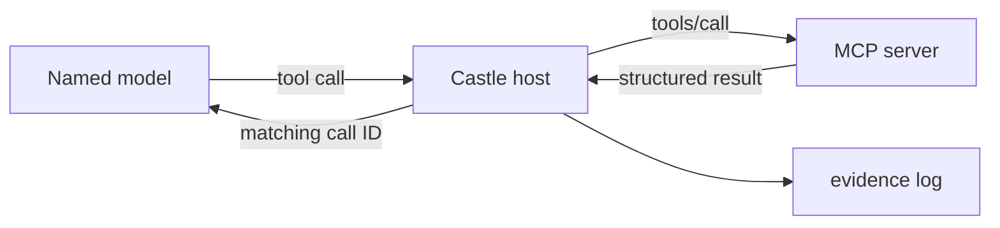
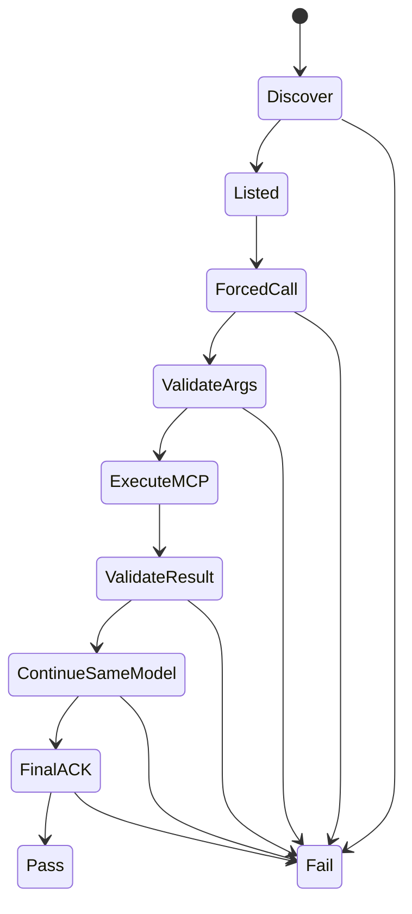

# OpenRouter + MCP Team Bus — Spec and Research Note v0.1

**Status:** design-ready; no live OpenRouter certification has been run from this branch  
**Observed:** 2026-10-13  
**Owners:** Mark is final gate; Meraki owns the acceptance probe and registry; Z owns parallel review packets  
**Primary outcome:** prove one complete `Hello World -> tool execution -> ACK` path, then reuse the same boundary for 20–40-question team digests.

## Decision in one page

There is no useful category called an “MCP-native model.” The Castle host is the MCP host/client. The model only emits provider-native tool calls. The host discovers MCP tools, translates their schemas, validates a model-proposed call, executes the MCP tool, and returns the result using the provider's matching tool-call ID.



The team should build two compatible paths:

| Path | Use | Choice |
|---|---|---|
| Local reference | Smallest inspectable proof, Chamber/Puppy work | Official MCP Python SDK v2, Python 3.11+, stdio, `mode="auto"` |
| Remote/team path | Multiple remote MCP servers and OpenRouter models | Pin `@openrouter/agent`; import canonical `@openrouter/agent/mcp`; Streamable HTTP/SSE |

Keep the existing dependency-light Python/OpenRouter runner as the audit/reference implementation. Do not silently raise the whole Castle project's Python 3.10 floor; put MCP tooling in an optional Python 3.11 subproject.

“FOR SURE” means **a recent passing record for an exact model/provider/schema path**. Catalog tags only make a candidate eligible to test.

## What is documented and reusable now

### OpenRouter

- Normalized tool calling is documented. The client executes a tool and must preserve the assistant tool call, matching `tool_call_id`, and tool definitions in the continuation.
- `provider.require_parameters: true` keeps requests away from endpoints that cannot honor required parameters.
- Ordered `models` fallbacks handle API/provider errors. They do **not** detect a semantically bad HTTP-200 result such as prose instead of a tool call.
- Structured output uses strict JSON Schema, but must still be validated locally because enforcement differs by provider endpoint.
- Usage receipts include prompt, completion, reasoning, cached and total tokens plus cost. Native tokenizers differ, so cross-family counts are accounting, not a perfect complexity comparison.
- The Batch API is useful for asynchronous single-turn comparison and digest work. It does not perform a multi-turn client-side MCP loop.
- The Agent SDK can expose remote Streamable HTTP/SSE MCP tools directly to `callModel`. The canonical import is `@openrouter/agent/mcp`; `@openrouter/mcp` is now a compatibility facade. stdio is intentionally out of scope.

Official starting points:

- [Tool calling](https://openrouter.ai/docs/guides/features/tool-calling)
- [Provider selection](https://openrouter.ai/docs/guides/routing/provider-selection)
- [Model fallbacks](https://openrouter.ai/docs/guides/routing/model-fallbacks)
- [Structured outputs](https://openrouter.ai/docs/guides/features/structured-outputs)
- [Usage accounting](https://openrouter.ai/docs/cookbook/administration/usage-accounting)
- [Batch API](https://openrouter.ai/docs/batch-quickstart)
- [Agent SDK MCP tools](https://openrouter.ai/docs/agent-sdk/call-model/mcp-tools)
- [Open Agent SDK repository](https://github.com/OpenRouterTeam/typescript-agent) — Apache-2.0; pin an exact beta version

### MCP, current protocol

The stable core revision observed for this note is `2026-07-28`. It is stateless per request and differs materially from many 2025 examples: modern discovery uses `server/discover`; protocol/session initialization from older tutorials is no longer the only path. The official Python SDK v2 `mode="auto"` tries modern discovery and falls back to legacy initialization.

- Use the SDK instead of hand-writing version negotiation.
- MCP tools are model-controlled affordances, not security boundaries.
- `readOnlyHint`, `destructiveHint`, `idempotentHint`, and `openWorldHint` are untrusted hints, not enforcement.
- The host owns policy, credentials, context aggregation, authorization and cross-server work.
- Use a resource for a frozen question packet and one tool for the submitted digest. Do not create 24 tiny tool turns.
- Current core has no JSON-RPC batch. An `answers[]` field in one tool call is application-level batching and is fine.
- Tasks are still a draft extension; they are not required for v0.

Official starting points:

- [Architecture](https://modelcontextprotocol.io/specification/2026-07-28/architecture)
- [Tools](https://modelcontextprotocol.io/specification/2026-07-28/server/tools)
- [Resources](https://modelcontextprotocol.io/specification/2026-07-28/server/resources)
- [stdio transport](https://modelcontextprotocol.io/specification/2026-07-28/basic/transports/stdio)
- [Streamable HTTP](https://modelcontextprotocol.io/specification/2026-07-28/basic/transports/streamable-http)
- [Authorization](https://modelcontextprotocol.io/specification/2026-07-28/basic/authorization)
- [Official Python SDK](https://github.com/modelcontextprotocol/python-sdk)

## M0/M1: Hello World and ACK

Use one deterministic tool named `hello_world`. Its committed declaration is in [`specs/team/hello-world-tool.json`](../specs/team/hello-world-tool.json).

Input:

```json
{
  "phrase": "Hello World",
  "nonce": "host-generated-random-challenge"
}
```

Output:

```json
{
  "echo": "Hello World",
  "nonce": "host-generated-random-challenge",
  "ack": {"code": "0xA", "state": "ACK_VERIFIED"},
  "schema_version": "1"
}
```

The nonce is deliberately required. A zero-argument smoke test proves that a server starts; it does not prove argument fidelity or result dependence.

### Acceptance state machine



PASS requires all of the following:

1. SDK discovery/negotiation and `tools/list` succeeded.
2. Request 1 forced exactly one `hello_world` tool call with `parallel_tool_calls: false`.
3. Arguments are valid JSON, match the schema, and contain the exact host nonce.
4. The MCP server actually executed once; model prose claiming execution never counts.
5. `structuredContent` validates and returns the exact nonce and `ACK_VERIFIED (0xA)`.
6. Request 2 uses the same named model, preserves the assistant tool call, supplies a matching provider `tool_call_id`, and repeats the tool definitions.
7. Final output validates as `HELLO_WORLD_ACK:<nonce>`.
8. Transcript, requested model, returned model, generation ID, timing, usage/cost, tool catalog hash and MCP server manifest are recorded.

Caps: two OpenRouter calls, one MCP execution, 30 seconds per call, no repair inside the acceptance probe. Keep provider tool-call IDs and MCP JSON-RPC request IDs in separate namespaces.

Failure enums:

`TRANSPORT_FAIL`, `NO_TOOL_CALL`, `DUPLICATE_TOOL_CALL`, `BAD_TOOL_NAME`, `BAD_ARGUMENT_JSON`, `BAD_ARGUMENT_SCHEMA`, `MCP_CALL_FAIL`, `BAD_RESULT_SCHEMA`, `NONCE_MISMATCH`, `TOOL_ID_MISMATCH`, `MODEL_CHANGED`, `NO_FINAL_ACK`, `BAD_FINAL_ACK`, `USAGE_MISSING`.

M0 is a direct SDK/Inspector call with no model. M1 is the live two-call probe. M2 is the 24-question digest. M3 intentionally fails a model and proves clean fallback. M4 joins Z's parallel review by packet hash.

## Two fallback systems, never confused

| Failure class | Owner | Behavior |
|---|---|---|
| Provider outage, rate limit, context rejection, moderation error | OpenRouter routing | Provider or ordered model error fallback may run |
| No call, wrong tool, malformed args, invalid ACK, fake prose, repeated call | Castle controller | Deterministically fail the attempt and advance the verified model ladder |

Policy:

- One correctable schema/tool mistake in digest mode: one same-model repair.
- Hard incompatibility: switch immediately.
- Any second behavioral failure: quarantine that model for this packet and switch.
- One bounded `Retry-After` for a transient 429/5xx; then switch.
- Maximum three models per packet; then return `PARTIAL_FAILED` with receipts.
- A replacement model receives a clean transcript plus the same immutable packet/hash. It never inherits another model's partial assistant/tool history.
- Never replay a completed side-effecting tool because final prose was absent. Call state is `proposed -> validated -> approved -> executing -> completed|failed|unknown`. `unknown` is not safe to retry without an idempotency key or independent proof.

For evaluation, use explicit model IDs. `openrouter/free` and Auto Router are discovery lanes, not reproducible baselines.

## Candidate ladders, not certifications

All price, availability and capability claims are observations from 2026-10-13 and must be refreshed before use. No row becomes `VERIFIED_TOOL_PATH` until M1 and M2 pass live.

| Lane | Candidate order | Why it is on the shortlist |
|---|---|---|
| Zero-cost exploration | `openai/gpt-oss-20b:free` -> `qwen/qwen3-coder:free` -> `mistralai/mistral-small-3.2-24b-instruct:free` | Free route candidates advertising tool use; failed calls still consume quota; identity/provider must be recorded |
| Low-cost primary | `openai/gpt-oss-20b` | Many provider paths, low price, documented tools/tool-choice/JSON-schema support |
| Low-cost alternate | `qwen/qwen3-coder-30b-a3b-instruct` | Long context and documented tools/structured output |
| Z/Mistral lane | `mistralai/mistral-small-2603` | Keeps a distinct provider/model family available to Z |
| Insurance/large digest | `anthropic/claude-haiku-5.5` | Large context and documented tool/structured-output support |

Before each qualification run, query the model's endpoints and require an endpoint advertising the necessary parameters. Use `provider.require_parameters: true`. Save both requested and returned model identifiers.

### “BERT-ish” preflight without pretending it is BERT

OpenRouter's Decisions modality can answer many typed probabilistic questions about one shared state. Perplexity Decider accepts up to 128; GPT-6 Luna Decisions accepts up to 200. This fits tags, deal-breaker flags, routing, rubric scoring, ACK-state selection and search-party triage. It does **not** replace an agent writing 20 substantive open-ended answers.

Use it as a cheap preflight:

1. classify which questions are answerable, risky, duplicated or require search;
2. route only the flagged/open questions to full digest agents;
3. record probabilities and thresholds, never convert them into unexplained verdicts.

## M2: one digest, 20–40 questions

Real-time chat is secondary. The unit of work is one immutable packet, not one prompt per question.

The packet schema is [`question-packet.schema.json`](../specs/team/question-packet.schema.json). Each answer uses:

```json
{
  "question_id": "Q017",
  "status": "answered",
  "answer": "Bounded substantive answer.",
  "confidence": "medium",
  "evidence_refs": ["source-2#section-4"],
  "next_probe": "One useful follow-up or null"
}
```

The digest tool accepts the committed [`digest-submission.schema.json`](../specs/team/digest-submission.schema.json). The server, not the model, injects agent/model/provider identity, timestamps, hashes, usage and cost.

Recommended MCP shape:

- resource: `castle://expeditions/{run_id}/packet`
- tool: `submit_digest(packet_handle, packet_sha256, answers[], cross_findings[])`
- output: bounded `ACK_DIGEST` or enumerated NAK plus server receipt/hash

Limits: 20–40 questions; 512 characters per answer; up to 6 evidence refs; up to 8 cross-findings; maximum three inference turns, three MCP calls and one repair.

The response must include these “two prompts away” fields so Mark does not have to chase the next useful branch:

- `next_probe` on each unresolved answer;
- `cross_findings` for connections spanning questions;
- `nearby_moves` with at most three adjacent actions, each naming expected value and cost/risk;
- explicit `unknown` and `blocked` statuses rather than polished filler.

Use Batch for many independent one-shot comparisons or for sending the same self-contained packet to several models. Use the normal tool loop when the digest must read an MCP resource and submit through MCP.

## Z's parallel lane

Z receives the exact packet and SHA-256 at the same time as the primary agent. Z never edits the primary answer and never blocks its completion. If live Mistral/MCP integration is unavailable, JSON export/import is the transport; the contract does not change.

Z returns [`z-review.schema.json`](../specs/team/z-review.schema.json): agree, disagree, missing or risk per question, plus bounded global gaps. `blocking-proposal` is display language for Mark, not automated authority. Merge is a side-by-side join on `question_id`.

Puppy/space remains a separate track value in the same packet schema. It can proceed with Z while talks and the OpenRouter acceptance probe proceed elsewhere.

## T3/Theo: adopt the layer, do not clone it blindly

[T3 Code](https://github.com/pingdotgg/t3code) is now the strongest reusable open layer found in this research. It is MIT-licensed and already exposes an MCP orchestration surface for delegation, task status/cancel, thread create/send/read/wait/interrupt, provider/model selection and scheduled work. Its durable event log, transactional projections/outbox, stable request IDs and asynchronous completion behavior directly overlap Castle's proposed team-flow layer.

T3 also documents portable cross-provider handoffs that preserve bounded original/recent/relevant messages rather than relying on a model-written summary. External agents can connect to its HTTP/OAuth MCP surface with permission modes. OpenRouter use is currently indirect through a separately configured Claude Code instance and must be checked in the OpenRouter dashboard; it is not proof that arbitrary OpenRouter models pass our ACK contract.

For Meraki as an outside controller, the honest first path is:

1. connect to T3 `/mcp` through OAuth;
2. call `orchestrator_capabilities` and record the live provider/model IDs;
3. call `t3_thread_launch` with an explicit model and `Return HELLO_WORLD`;
4. `t3_thread_wait`, then `t3_thread_read`, and verify the durable result;
5. launch an orchestrator thread whose agent performs the ACK tool call, then read its receipt.

An outside MCP session has no parent T3 thread, so it cannot begin with `delegate_task`. Delegated tasks also receive no parent conversation automatically: every Castle packet must be self-contained. `t3_thread_launch` has no idempotency key; retain its returned thread ID and inspect existing threads before retrying a lost response to avoid duplicate work.

Decision:

- Make T3 Code an optional orchestration/control surface now.
- Keep Castle's packet, digest, ACK, evidence and verified-model schemas provider-neutral.
- Connect T3 through those schemas when present; keep the lightweight OpenRouter runner as fallback/direct path.
- Do not import T3's private workspace packages as if they were a stable public SDK. Run/fork T3 or adapt specific MIT-licensed patterns with attribution.
- T3 capability discovery tells us provider/model options; it does not supply semantic tags such as `MCP_HAPPY` or `best_researcher`. Castle's dated qualification registry still matters.
- Qualify more than the first reply: model discovery, MCP invocation, result continuation, history replay, STOP/cancel and helper-model behavior can fail independently.

Theo's [ts-rust](https://github.com/pingdotgg/ts-rust) is useful process evidence: bounded lanes, strict ownership, deterministic gates/oracles and constrained agent work. It is project scaffolding, not a reusable model router.

## Coding-hole escape ladder

Stop polishing the same broken approach after one or two attempts:

1. MCP wire/schema bug -> official MCP v2 SDK, in-process client test, then MCP Inspector.
2. OpenRouter serialization bug -> official `openrouter` Python SDK or pinned OpenRouter Agent SDK; preserve Castle's evidence envelope.
3. Model fails the forced call twice -> advance to the next locally verified model; do not endlessly rewrite the prompt.
4. Digest schema is too large -> reduce answer caps or submit deterministic chunks with a final receipt; do not create 24 chats.
5. Custom team UI/orchestration grows costly -> run T3 Code as optional control surface.
6. Need a second open host -> Qwen Code is Apache-2.0, headless, multi-protocol and MCP-capable; treat it as a host option, not evidence about any Qwen model.
7. Z unavailable -> export/import the same packet and review schema; primary work proceeds.

## Evidence record and capability registry

Every attempt records the committed [`model-capability.schema.json`](../specs/team/model-capability.schema.json) fields plus an append-only event envelope:

- run/attempt/packet IDs and hashes;
- requested model, returned model, provider and generation ID;
- MCP server manifest, tool catalog hash, tool name and provider tool-call ID;
- request/response hashes, status/failure enum, duration;
- native prompt/completion/reasoning/cached/total tokens and cost, or explicit `null`;
- previous-event and current-event hashes.

Provider usage is authoritative. A local estimate is labeled `estimate` and never merged with billed usage. Secrets and content fragments do not enter evidence events.

Eligibility:

- `HELLO_ACK_PASS` no older than 7 days;
- stable returned model within the transaction;
- `DIGEST24_PASS` for digest work;
- receipts and transcript hashes present;
- exact schema/tool catalog hash match.

Any model or provider change makes the result stale, not silently inherited.

## Build order

1. Commit schemas, canonical JSON/hash rules and failure enums.
2. In-process fake MCP tests.
3. Local Python stdio `hello_world` server; prove direct call with SDK/Inspector.
4. OpenRouter-to-MCP bridge; run M1 against one explicit candidate.
5. Capability registry and evidence JSONL.
6. Synthetic 24-question packet; run M2.
7. Failure fixtures: fake prose, malformed args, nonce mismatch, repeated call, 429, model change, missing final ACK.
8. M3 clean fallback to a second verified model.
9. Z export/import plus M4 side-by-side join.
10. Optional T3 adapter; then a real team packet.

The first live milestone is intentionally boring: **one named model caused one actual MCP tool execution and acknowledged the server-returned nonce, with a complete receipt.** Everything else earns the right to exist after that.
